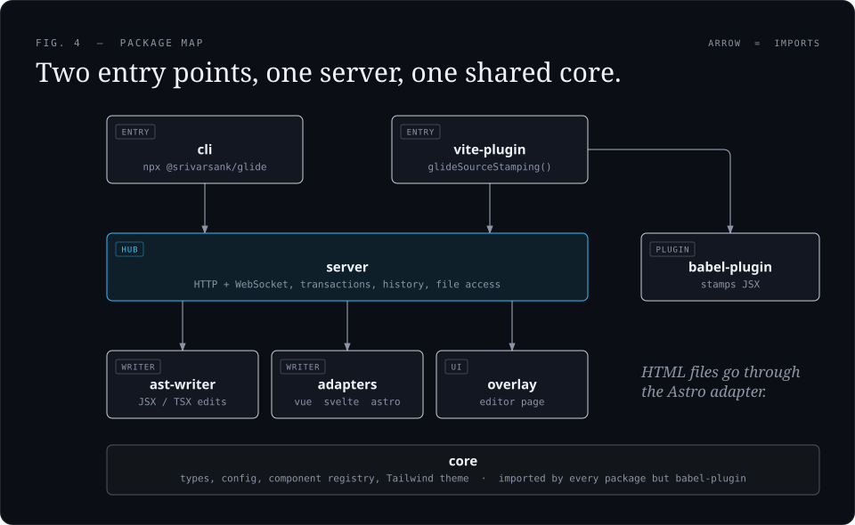

<p align="center">
  
</p>

<p align="center">
  <a href="#set-up-a-checkout"><b>Set up</b></a>
  &nbsp;·&nbsp;
  <a href="#find-your-way-around"><b>Package map</b></a>
  &nbsp;·&nbsp;
  <a href="#develop-and-check"><b>Checks</b></a>
  &nbsp;·&nbsp;
  <a href="#open-a-pull-request"><b>Pull requests</b></a>
  &nbsp;·&nbsp;
  <a href="#releases-maintainers"><b>Releases</b></a>
</p>

<br>

Glide is an npm workspace that publishes one package, `@srivarsank/glide`. The packages under `packages/` are private modules that the build bundles into it.

## Set up a checkout

You need Node.js 20 (the CI version, also in `.nvmrc`), npm and Git. The published package's engine requirement stays in `package.json`. Local development needs no API key and no `.env` file.

```sh
git clone https://github.com/YOUR-USERNAME/Glide.git
cd Glide
npm ci
npm run build
npm run typecheck
npm test
npm run test:artifact
```

Build before you typecheck: internal workspace imports resolve through the generated declarations in `packages/*/dist/`. Tests resolve workspace imports straight to source through `vitest.config.ts`.

Use npm for this repository, and commit `package-lock.json` with any dependency change. There is no second task runner or lockfile.

## Find your way around

<p align="center">
  
</p>

| Location | Responsibility |
| --- | --- |
| `packages/core/src/` | Shared types, config, source discovery, tree building, tokens |
| `packages/ast-writer/src/` | JSX/TSX source edits and formatting preservation |
| `packages/adapters/{vue,svelte,astro}/src/` | Template edits; the Astro adapter also edits HTML files |
| `packages/overlay/src/` | Editor page, browser modules, canvas, selection and snapping |
| `packages/server/src/` | HTTP and WebSocket endpoints, transactions, history, file access |
| `packages/vite-plugin/src/` | Source stamping, the browser bridge, and the editor at `/__glide/` |
| `packages/babel-plugin/src/` | JSX source-location stamping |
| `packages/cli/src/` | The `glide` command and skill installation |
| `src/index.ts` | Public library exports |
| `src/__tests__/` | All Vitest suites and their helpers |
| `scripts/` | Build, typecheck and packaged-product acceptance checks |
| `skills/` | Agent skills shipped with the npm package |

React editing goes through the AST writer. `packages/overlay/src/editor-html.ts` generates the editor page; its history UI does not use React or Jotai. Read the [documentation index](docs/README.md) before you treat an older design specification as a description of the current code.

## Develop and check

| Command | What it does |
| --- | --- |
| `npm run build` | Compile the internal modules and bundle JavaScript, declarations and skills |
| `npm run typecheck` | Check every workspace and the root, including unused locals and parameters |
| `npm test` | Run all Vitest suites |
| `npm run test:watch` | Watch the source tests while you edit |
| `npm test -- src/__tests__/writer.test.ts` | Run one suite |
| `npm run test:artifact` | Check the built editor script and mutation transport |
| `npm run test:consumer` | Install the packed tarball in isolation and exercise the CLI and editor in Chromium |
| `npm run test:hosted` | Exercise the editor hosted by Vite, and cross-origin isolation, in Chromium |
| `npm run verify:release` | Build, then run every release check above |

Before the browser checks, install Chromium with `npx playwright install chromium` (Linux CI adds `--with-deps`). The consumer check needs access to npm to install the packed tarball's dependencies.

Rebuild after a change when you test the bundled editor or CLI. A build clears the compiled output of the internal packages, so a deleted source module cannot leave a stale file behind. It also copies the three bundled skills into the ignored `.agents/skills/` folder.

## Open a pull request

Keep collaboration respectful. For a substantial change in behavior, open an issue first to agree on it, and keep each pull request to one concern.

1. Preserve source formatting, and edit only the selected authored node.
2. Keep public exports compatible unless a breaking change is agreed.
3. Add regression tests under `src/__tests__/` for behavior changes. Vitest does not discover tests anywhere else.
4. Run the setup checks above. For browser, CLI or packaging changes, also run `npm run verify:release`.
5. In the pull request, describe the problem, the new behavior and how you checked it. Add a screenshot when you change what the editor shows.

Write atomic commits as `type(scope): imperative summary`, for example `fix(ast-writer): preserve comments during class edits`. Keep formatting changes apart from behavior changes. Do not commit generated `dist/`, `node_modules/`, local agent output, credentials or unrelated files.

Report security problems privately, as [SECURITY.md](SECURITY.md) describes, not in a public issue.

### Images in the docs

The figures in the README and in this guide live in [`.github/assets/docs/`](.github/assets/docs/). They follow one style, adapted from [diagram-design](https://github.com/cathrynlavery/diagram-design). Keep to it when you add or change one:

- **Color.** Paper `#0b0e14`, ink `#eef1f5`, muted `#8b95a7`, and one accent, `#38bdf8`, on at most two elements per figure.
- **Type.** Instrument Serif for titles, Geist for names, Geist Mono only for code, paths and labels.
- **Shape.** 1 px borders, 6 px corners on nodes, right-angle connectors, no shadows or glows.
- **Fonts travel with the file.** Each SVG embeds a Latin-1 subset of its fonts, so you can change its text in a text editor.
- **Screenshots** come from the real editor, 1920 px wide, with the same rounded corners as the figures.

## Releases (maintainers)

`.github/workflows/publish.yml` runs when a GitHub Release is published or when the workflow is started by hand. A tag push alone does not start it. The workflow gates both registry publish jobs on `npm run verify:release`.

`publish-npm` uses `NPM_TOKEN` and publishes with provenance. `publish-github` uses the repository `GITHUB_TOKEN`; the repository `.npmrc` pins the `@srivarsank` scope to npmjs, so it passes `--@srivarsank:registry` rather than `--registry`. To finish a release whose GitHub Packages job failed, start the workflow by hand: the npm job skips a version npm already has. CI on every pull request builds, checks the types of all workspaces, runs the source tests, checks the bundled editor, and runs the consumer and hosted browser checks.

The manual publishing scripts (`publish:npm`, `publish:gpr`, `publish:all` and `release`) publish the existing build output and do not check it. Run `npm run verify:release` first.
