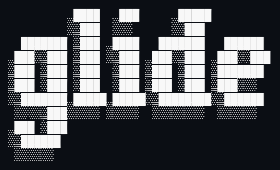
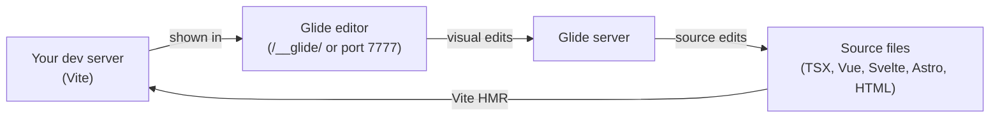
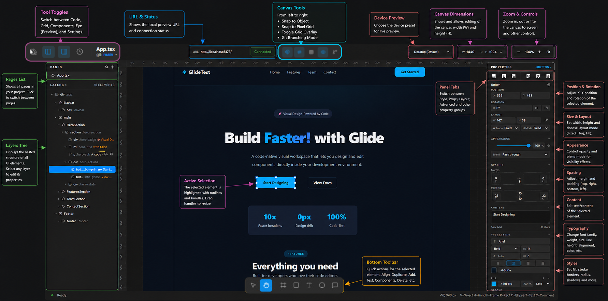

<p align="center">
  
</p>

<p align="center">
  <strong>Local visual design tool for React, Vue, Svelte, and Astro.</strong><br>
  Select elements on a live canvas, adjust styles and layout visually, and write changes directly back to your source files.
</p>

<p align="center">
  <a href="https://www.npmjs.com/package/@srivarsank/glide"></a>
  <a href="https://github.com/SrivarsanK/Glide/pkgs/npm/glide"></a>
  <a href="https://github.com/SrivarsanK/Glide/actions/workflows/ci.yml"></a>
  
  
  
</p>

---

## What is Glide?

Glide is a local visual editor for frontend projects. It runs in your browser and connects to your local dev server, letting you select elements on screen, move them, and change their styling.

Unlike design tools that export mockups or save into closed formats, Glide modifies your actual source files. When you change a color, adjust padding, or drag an element into a new container, Glide edits that element in your JSX, TSX, Vue, Svelte, Astro, or HTML file. Your code remains clean, formatting stays intact, and you stay in control of version control.

---

## How it works

Glide shows your running app in an iframe. A local WebSocket server receives each visual edit and writes it to your source files.



1. Add the `glideSourceStamping()` plugin to your Vite config. In dev mode, it marks each element with its file, line and column.
2. Run your dev server as usual (`npm run dev`).
3. Open the editor address that the dev server prints, such as `http://127.0.0.1:5173/__glide/`.
4. Click elements on the canvas to inspect their properties, change styles, or drag them.
5. Glide writes each change to the exact element in your source file.
6. When you change a file in your code editor, the canvas updates without an iframe reload.

You can also run Glide as a separate command: `npx @srivarsank/glide 5173`, then open `http://localhost:7777`. In this mode Glide shows your app through a proxy.

### What Glide can save

| File type | Class, inline style, text, drag and resize | Structural edits (insert, delete, move, group) |
|---|---|---|
| JSX / TSX | Yes | Yes |
| Vue, Svelte, Astro | Yes | No |
| HTML | Yes, in projects with no UI framework | No |

Glide refuses an edit that it cannot make exactly, for example a dynamic `:class` binding or a `{...spread}`. The message gives the reason, and the file stays unchanged.

---

## Architecture

```
Canvas edits                               External code edits
     │                                              │
     ▼                                              ▼
Editor sends one transaction                File watcher
(with a digest of the file)                 (ignores Glide's own writes)
     │                                              │
     ▼                                              ▼
Server checks session, path, digest         Tree and scene update events
     │                                              │
     ▼                                              ▼
Source edit in memory → temp file → rename  Editor refreshes the canvas
```

- **Exact targeting:** Each element is found by its file, line and column. JSX elements also have a content hash, so an edit to a changed element is refused (`STALE_NODE`).
- **Safe writes:** Each transaction carries a SHA-256 digest of the file. If the file changed since you selected the element, Glide refuses the edit (`STALE_DIGEST`). A transaction writes all of its files or none of them.
- **Minimal diffs:** Glide changes only the edited text. Formatting, comments and quotes stay as you wrote them.
- **Surgical Tailwind updates:** Glide replaces only the classes for the edited property, such as `bg-` or `text-`. Responsive and state variants stay. Values that match your Tailwind theme are written as theme tokens.
- **Class expressions:** In JSX, Glide edits classes inside `cn(...)`, `clsx(...)`, `cva(...)` and template literals. It refuses an edit that a condition or shared definition would override.
- **Edit scopes:** For an element inside a component, you can apply a class to the component definition, to one usage, or to one `cva` variant.
- **Staged edits:** You can preview many changes and write them in one transaction from the staging bar.
- **Drag and resize:** The result is written to source as layout styles. Elements in normal flow get `position: relative`, so flex and grid layout stays.
- **Session security:** The server listens on `127.0.0.1` only, checks the `Host` and `Origin` of each request, and accepts a socket only after a session token handshake.

---

## Quick start

Glide is available on the public npm registry and GitHub Packages.

### Option A: Run directly via npx

Start your app in one terminal, then point Glide at its port:

```bash
# Terminal 1: your app
npm run dev

# Terminal 2: start Glide targeting your app's port
npx @srivarsank/glide 5173
```

Then open **http://localhost:7777** in your browser.

### Option B: Install as a dev dependency

```bash
npm install -D @srivarsank/glide
```

You can add a script to `package.json`:

```json
{
  "scripts": {
    "glide": "glide 5173"
  }
}
```

### Option C: GitHub Packages

If your team consumes packages from GitHub Packages:

1. Add the scope mapping to your `.npmrc`:
   ```ini
   @srivarsank:registry=https://npm.pkg.github.com
   ```
2. Authenticate with a personal access token:
   ```bash
   npm login --registry=https://npm.pkg.github.com
   ```
3. Run via npx:
   ```bash
   npx @srivarsank/glide 5173
   ```

---

## Vite plugin configuration

To enable click-to-element mapping, add the `glideSourceStamping` plugin to your Vite configuration. This stamps elements with source file locations during development.

With the plugin installed you do not need the `glide` command: run your dev server as usual and open the address it prints, such as **http://127.0.0.1:5173/__glide/**. The editor is served by Vite itself, so the preview loads your app directly and hot module replacement works as it does without Glide.

The editor uses the loopback IP address and the preview loads your app from `localhost`. These are different origins for the browser, so scripts in your app cannot read the editor page or send edits. If you open `http://localhost:5173/__glide/`, Glide sends you to the IP address. Pass `glideSourceStamping({ editor: false })` to keep using the `glide` command instead.

**React (`vite.config.ts`):**
```ts
import { defineConfig } from 'vite';
import react from '@vitejs/plugin-react';
import { glideSourceStamping } from '@srivarsank/glide/vite-plugin';

export default defineConfig({
  plugins: [react(), glideSourceStamping()],
});
```

**Vue (`vite.config.ts`):**
```ts
import { defineConfig } from 'vite';
import vue from '@vitejs/plugin-vue';
import { glideSourceStamping } from '@srivarsank/glide/vite-plugin';

export default defineConfig({
  plugins: [vue(), glideSourceStamping()],
});
```

**Svelte (`vite.config.ts`):**
```ts
import { defineConfig } from 'vite';
import { svelte } from '@sveltejs/vite-plugin-svelte';
import { glideSourceStamping } from '@srivarsank/glide/vite-plugin';

export default defineConfig({
  plugins: [svelte(), glideSourceStamping()],
});
```

**Astro (`astro.config.mjs`):**
```ts
import { defineConfig } from 'astro/config';
import { glideSourceStamping } from '@srivarsank/glide/vite-plugin';

export default defineConfig({
  vite: {
    plugins: [glideSourceStamping()],
  },
});
```

**Plain HTML with Vite:**
```ts
import { defineConfig } from 'vite';
import { glideSourceStamping } from '@srivarsank/glide/vite-plugin';

export default defineConfig({
  plugins: [glideSourceStamping()],
});
```

---

## AI agent skills

Glide includes bundled skills that teach AI assistants (including Antigravity IDE, Claude Code, Cursor, Windsurf, and GitHub Copilot) how to inspect and modify components directly through Glide.

### Installing skills

Run the installer from your project root:

```bash
npx @srivarsank/glide --install-skills
```

This installs three structured skills into `.agents/skills/`:
- `glide`: Architecture guide, SceneGraph hit testing, and visual editing patterns.
- `glide-component-segregator`: Component registry lookup using `glide-components.json`.
- `glide-setup`: Setup and configuration steps for all supported frameworks.

If you use Cursor, the installer also creates `.cursor/rules/glide.mdc`.

### The component registry (`glide-components.json`)

When Glide starts, it indexes every component in your project into `glide-components.json`. AI agents use this registry to locate components by name rather than searching raw file trees:

```json
{
  "buckets": [
    {
      "name": "Card",
      "file": "/src/components/Card.tsx",
      "exportType": "named",
      "line": 12,
      "elements": [
        { "id": "src/Card.tsx:13:4", "tagName": "div", "isRoot": true, "classNames": ["card"] },
        { "id": "src/Card.tsx:14:6", "tagName": "h2", "isRoot": false }
      ],
      "cssFiles": ["/src/components/Card.module.css"]
    }
  ]
}
```

The file updates within 300 ms when you create, rename, or delete components. Both the `glide` command and the editor at `/__glide/` write this file.

Add the registry to your `.gitignore`:
```gitignore
glide-components.json
```

### Agent workflow

When an AI assistant needs to modify a component visually, it follows these steps:
1. Read `glide-components.json`.
2. Locate the bucket matching the component name (such as "Card" or "Header").
3. Inspect elements to find the target `data-gl-source` id by tag name, root wrapper, or classes.
4. For CSS module modifications, open the file listed in `cssFiles`.
5. Apply the surgical edit and verify on canvas.

---

## Features

<p align="center">
  
</p>

| Feature | Description |
|---|---|
| Visual canvas | Select, drag, resize, zoom, and pan elements on a live canvas |
| Code-to-canvas sync | External code changes update the canvas without reloading the page |
| Smart snapping | Snaps to sibling edges, centers, and grid lines with visual guides |
| Source write-back | Class, style, text and layout edits for JSX/TSX, Vue, Svelte, Astro, and HTML |
| Surgical Tailwind rewriter | Replaces specific utility tokens while preserving other classes |
| Class expressions | Edits classes in `cn`, `clsx`, `cva` and template literals (JSX) |
| Edit scopes | Apply a class to a component definition, one usage, or one `cva` variant |
| Canvas reparenting | Drag elements between containers to update parent-child JSX structure |
| Canvas pasteboard | Detach elements to the canvas; they stay in source and do not render |
| Component definition jump | Jump from an instantiated sub-component to its origin file in one click |
| Conflict safety | File digest checks and all-or-nothing transactions prevent lost or partial writes |
| Layers panel | Hierarchical element tree with visibility and selection controls |
| Properties panel | Control dimensions, margins, padding, borders, shadows, and typography |
| Color picker | Custom popup picker with hex input and preset palettes |
| Device preview | Toggle between responsive presets or define custom canvas dimensions |
| Git sandbox mode | Test visual changes on a dedicated branch before committing |
| Quick toggles bar | Compact controls for snapping, pixel grid, rulers, and file paths |
| Undo and redo | Full session history with undo and redo controls |
| Component registry | Automatic component indexing saved to `glide-components.json` |

---

## Keyboard shortcuts

| Key | Action |
|---|---|
| `V` | Select tool |
| `H` | Hand and pan tool |
| `F` | Frame tool |
| `R` | Rectangle tool |
| `O` | Ellipse tool |
| `T` | Text tool |
| `C` | Comment tool |
| `Ctrl+Z` | Undo |
| `Ctrl+Shift+Z` | Redo |
| `Escape` | Deselect or close modal |

---

## Color picker

Glide uses a custom popup color picker rather than the native operating system dialog. Click any color swatch in the properties panel to open it.

You can select from 16 presets, type a hex color code, or use the eyedropper tool. Note that on some Chromium builds, the browser eyedropper API can occasionally fail to close; typing hex codes or choosing presets is recommended if you encounter this browser issue.

---

## Project structure

```
Glide/
├── packages/
│   ├── cli/            # CLI launcher (npx @srivarsank/glide)
│   ├── overlay/        # Editor UI (served at /__glide/ or localhost:7777)
│   ├── server/         # WebSocket server, proxy, transactions, history
│   ├── core/           # Shared types, config, component registry, Tailwind theme
│   ├── ast-writer/     # JSX source edits (Recast and Babel)
│   ├── adapters/       # Template writers (Vue, Svelte, Astro/HTML)
│   ├── babel-plugin/   # JSX source stamping
│   └── vite-plugin/    # Stamping, bridge injection, editor hosting (glideSourceStamping)
├── docs/               # Architecture specs, design docs, and guides
│   ├── reports/        # Audit, completion, and remaining work reports
│   └── INSTALL.md      # Detailed manual & agent installation guide
├── src/                # Package root entrypoints & version resolution
│   └── __tests__/      # Centralized Vitest test suite
├── skills/             # Bundled AI agent skills
│   ├── glide/
│   ├── glide-component-segregator/
│   └── glide-setup/
└── README.md
```

---

## Contributing

Contributions are welcome.

- Review the [Contributing Guide](CONTRIBUTING.md) for local architecture details and testing procedures.
- We follow conventional commit conventions for atomic commits.
- Use the [documentation index](docs/README.md) to distinguish current guides from historical specifications and audit reports.
- Check [skills/glide/references/](skills/glide/references/) for the architecture, the WebSocket protocol, and the write-back rules for each file type.

---

## License

This project is licensed under the [Apache License 2.0](LICENSE).

---

## Star history

<a href="https://www.star-history.com/?repos=srivarsank%2Fglide&type=date&legend=bottom-right">
  <picture>
    <source media="(prefers-color-scheme: dark)" srcset="https://api.star-history.com/chart?repos=srivarsank/glide&type=date&theme=dark&legend=bottom-right" />
    <source media="(prefers-color-scheme: light)" srcset="https://api.star-history.com/chart?repos=srivarsank/glide&type=date&legend=bottom-right" />
    
  </picture>
</a>
