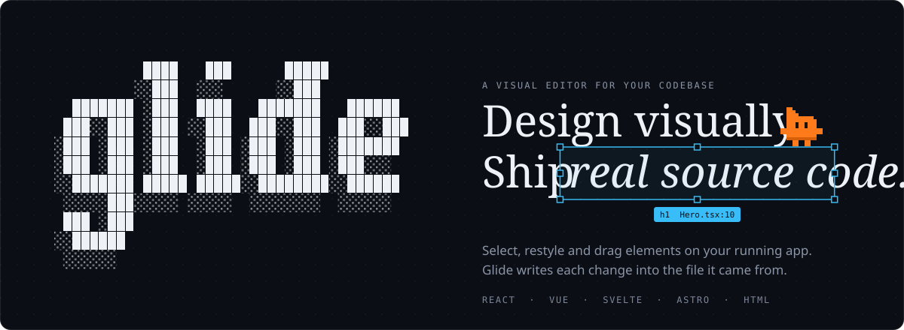
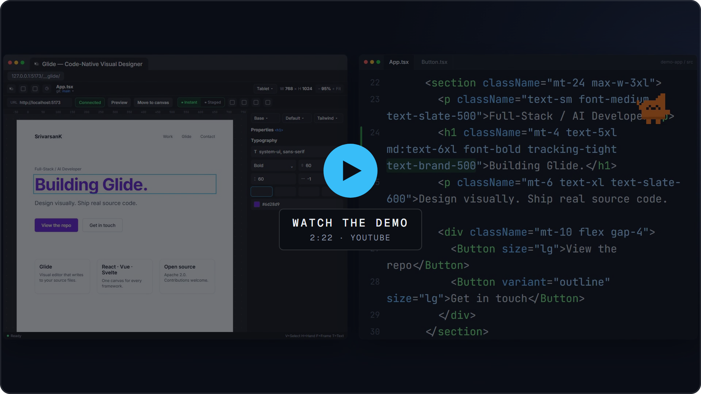
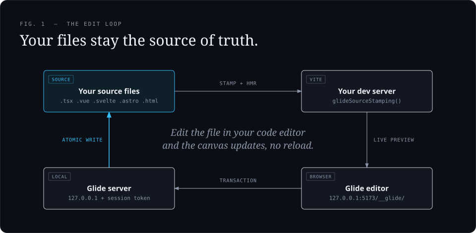
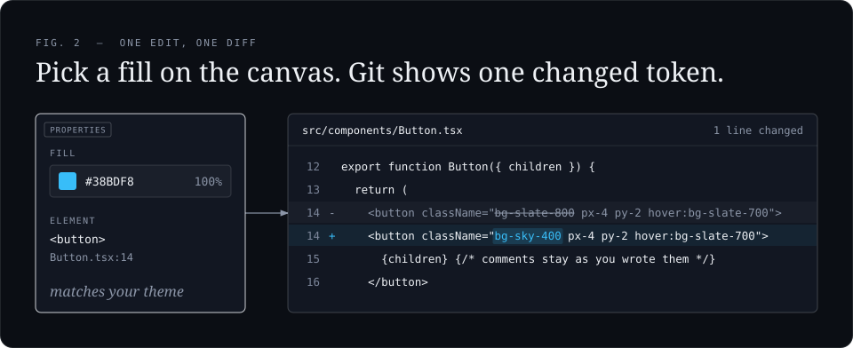
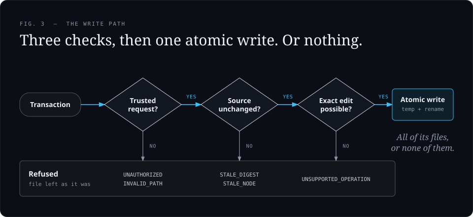
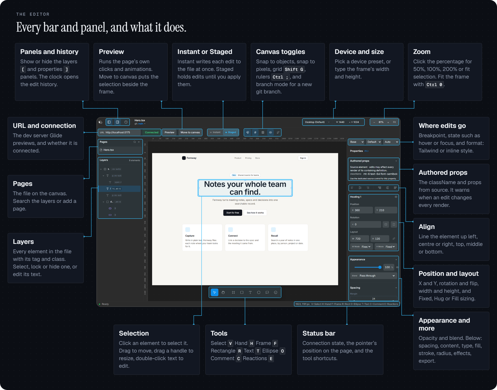

<p align="center">
  
</p>


<p align="center">
  <a href="https://www.npmjs.com/package/@srivarsank/glide"></a>
  <a href="https://github.com/SrivarsanK/Glide/stargazers"></a>
  <a href="https://github.com/SrivarsanK/Glide/actions/workflows/ci.yml"></a>
  
  <a href="LICENSE"></a>
  <br>
  <a href="#quick-start"></a>
  <a href="#quick-start"></a>
  <a href="#quick-start"></a>
  <a href="#quick-start"></a>
  <a href="#quick-start"></a>
</p>

<p align="center">
  <a href="#quick-start"><b>Quick start</b></a>
  &nbsp;·&nbsp;
  <a href="#how-it-works"><b>How it works</b></a>
  &nbsp;·&nbsp;
  <a href="#edits-you-can-review"><b>Safe edits</b></a>
  &nbsp;·&nbsp;
  <a href="#features"><b>Features</b></a>
  &nbsp;·&nbsp;
  <a href="#ai-agent-skills"><b>Agent skills</b></a>
  &nbsp;·&nbsp;
  <a href="CONTRIBUTING.md"><b>Contributing</b></a>
</p>

# Glide: Visual website editor - STOP MAKING MOCKUPS ANYMORE!
<br>

Glide is a visual editor for the app you already run. Open it on your dev server, select an element on the live page, and change it the way you would in a design tool. Glide writes each change into the JSX, Vue, Svelte, Astro or HTML that renders the element, so every edit ends up as an ordinary diff that you review and commit.

There is no design file to keep in sync and no export step. Your source files are the design.

<p align="center">
  <a href="https://www.youtube.com/watch?v=itpLGY9rQKU"></a>
  <br>
  <sub>Two minutes: install Glide, edit the page, and watch each change land in the source.</sub>
</p>

## Quick start

Glide works with Vite projects and needs Node.js 20 or later.

**1. Install it as a dev dependency.**

```bash
npm install -D @srivarsank/glide
```

**2. Add the plugin to your Vite config.** In development it marks each element with the file, line and column that rendered it.

```ts
// vite.config.ts
import { defineConfig } from 'vite';
import react from '@vitejs/plugin-react';
import { glideSourceStamping } from '@srivarsank/glide/vite-plugin';

export default defineConfig({
  plugins: [react(), glideSourceStamping()],
});
```

<details>
<summary><b>Vue, Svelte, Astro and plain HTML</b></summary>

<br>

**Vue** (`vite.config.ts`)

```ts
import { defineConfig } from 'vite';
import vue from '@vitejs/plugin-vue';
import { glideSourceStamping } from '@srivarsank/glide/vite-plugin';

export default defineConfig({
  plugins: [vue(), glideSourceStamping()],
});
```

**Svelte** (`vite.config.ts`)

```ts
import { defineConfig } from 'vite';
import { svelte } from '@sveltejs/vite-plugin-svelte';
import { glideSourceStamping } from '@srivarsank/glide/vite-plugin';

export default defineConfig({
  plugins: [svelte(), glideSourceStamping()],
});
```

**Astro** (`astro.config.mjs`)

```ts
import { defineConfig } from 'astro/config';
import { glideSourceStamping } from '@srivarsank/glide/vite-plugin';

export default defineConfig({
  vite: {
    plugins: [glideSourceStamping()],
  },
});
```

**Plain HTML** (`vite.config.ts`, no framework plugin needed)

```ts
import { defineConfig } from 'vite';
import { glideSourceStamping } from '@srivarsank/glide/vite-plugin';

export default defineConfig({
  plugins: [glideSourceStamping()],
});
```

</details>

**3. Run your dev server as usual and open the editor** at the address it prints, such as `http://127.0.0.1:5173/__glide/`.

```bash
npm run dev
```

Vite serves the editor itself, so the preview loads your app directly and hot module replacement works as it does without Glide.

<details>
<summary><b>Run the editor as a separate command instead</b></summary>

<br>

Start your app, then start Glide in a second terminal and open `http://localhost:7777`. With no port, Glide looks for your dev server.

```bash
npx @srivarsank/glide          # or: npx @srivarsank/glide 5173
```

To keep it with your other scripts, add `"glide": "glide"` to the `scripts` in `package.json`. In this mode Glide shows your app through a proxy. Keep the plugin in your Vite config so elements can be selected; to turn off the editor at `/__glide/`, pass `glideSourceStamping({ editor: false })`. Set `PORT` to change the editor port. Other settings are read from `glide.config.json`; see the [installation guide](docs/INSTALL.md).

</details>

<details>
<summary><b>Install from GitHub Packages</b></summary>

<br>

1. Map the scope in your `.npmrc`:
   ```ini
   @srivarsank:registry=https://npm.pkg.github.com
   ```
2. Sign in with a personal access token:
   ```bash
   npm login --registry=https://npm.pkg.github.com
   ```
3. Install as above: `npm install -D @srivarsank/glide`.

</details>

> [!NOTE]
> The editor page uses the loopback address (`127.0.0.1`) and the preview loads your app from `localhost`. The browser treats these as different origins, so scripts in your app cannot read the editor page or send edits. If you open `http://localhost:5173/__glide/`, Glide sends you to the IP address.

## How it works

<p align="center">
  
</p>

1. **Stamp.** The Vite plugin marks each element with its source location while your app compiles.
2. **Edit.** The editor shows your running app. Each change you make is sent as one transaction to a local server, with a digest of every file it touches.
3. **Write.** The server checks the transaction, edits only the affected text, and writes the file. Vite's hot reload updates the canvas without reloading the page.

Edits you make in your code editor go around the same loop, from your files through Vite to the canvas, so the two stay in sync.

### What Glide can save

| File type | Class, inline style, text, attributes (links, popovers), change tag, drag and resize | Structural edits (insert, delete, move, group) |
|---|:---:|:---:|
| JSX / TSX | Yes | Yes |
| Vue, Svelte, Astro | Yes | No |
| HTML | Yes, in projects with no UI framework | No |

Glide refuses an edit that it cannot make exactly, such as one inside a dynamic `:class` binding or a `{...spread}`. The message gives the reason, and the file stays unchanged.

## Edits you can review

<p align="center">
  
</p>

Glide changes the text of the edit and nothing else. Formatting, comments and quotes stay as you wrote them. With Tailwind, it replaces only the classes for the property you changed, keeps responsive and state variants such as `md:` and `hover:`, and writes values that match your theme as theme tokens.

<p align="center">
  
</p>

- **Exact targeting.** Each element is found by its file, line and column. JSX elements also carry a content hash, so an edit to an element that changed since you selected it is refused (`STALE_NODE`).
- **Stale-file checks.** Each transaction carries a SHA-256 digest of every file it touches. If a file changed since you selected the element, the edit is refused (`STALE_DIGEST`).
- **All or nothing.** A transaction writes all of its files or none of them, each through a temp file and a rename.
- **Class expressions.** In JSX, Glide edits classes inside `cn(...)`, `clsx(...)`, `cva(...)` and template literals. It refuses an edit that a condition or a shared definition would override.
- **Edit scopes.** For an element inside a component, you choose where a class goes: the component definition, one usage, or one `cva` variant.
- **Instant or staged.** Write each edit as you make it, or stage many edits, preview them, and apply them in one transaction.
- **Layout-safe drag and resize.** Results are written as layout styles. Elements in normal flow get `position: relative`, so flex and grid layout keeps working.
- **Local only.** The server listens on `127.0.0.1`, checks the `Host` and `Origin` of each request, and accepts a socket only after a session token handshake.

## Features

<p align="center">
  
  <br>
  <sub>Open the image for full size. The keyboard shortcuts are listed below the feature table.</sub>
</p>

<table>
<tr>
<th align="left" width="33%">On the canvas</th>
<th align="left" width="33%">In your source</th>
<th align="left" width="33%">Around your workflow</th>
</tr>
<tr>
<td valign="top">

- Select, drag, resize, zoom and pan on the live page
- Snapping to siblings, centers and the pixel grid, with guides
- Layers panel for each file's element tree
- Properties for size, layout, spacing, type, fill, borders and shadows
- Color picker with presets, hex input and the eyedropper
- Device presets and custom canvas sizes
- Frame, rectangle, ellipse and text tools
- A pasteboard: move an element off the page and it stays in source without rendering

</td>
<td valign="top">

- Class, inline style, text and layout edits in five file types
- Tailwind edits per property, with breakpoint (`sm` to `2xl`) and state (`hover`, `focus` and others) targets
- Style format: Auto, Tailwind or Inline
- `cn`, `clsx`, `cva` and template-literal classes
- Edit scopes for components and `cva` variants
- Insert, delete, move, group and reparent in JSX
- Jump from a component usage to its definition

</td>
<td valign="top">

- Instant writes or staged edits
- Undo and redo for the whole session, with a history panel
- Canvas updates when you edit code, without a reload
- Branch mode for trying changes on a Git branch
- Comments, reactions, and PNG or JPG export
- A component registry and skills for AI coding agents

</td>
</tr>
</table>

The color picker has 16 presets, hex input and the eyedropper. On some Chromium builds the browser's eyedropper does not close; type a hex value or choose a preset instead.

<details>
<summary><b>Keyboard shortcuts</b></summary>

<br>

`Ctrl` is `⌘` on macOS.

| Tools | | Editing | | View | |
|---|---|---|---|---|---|
| `V` | Select | `Ctrl Z` | Undo | `Ctrl 0` | Fit to screen |
| `H` | Hand | `Ctrl Shift Z` or `Ctrl Y` | Redo | `Ctrl 1` | Zoom to 100% |
| `F` or `A` | Frame | `Ctrl C` / `Ctrl V` | Copy / paste | `[` / `]` | Toggle left / right panel |
| `R` | Rectangle | `Ctrl D` | Duplicate | `\` | Toggle both panels |
| `O` | Ellipse | `Delete` or `Backspace` | Delete | `Ctrl Alt H` | History panel |
| `T` | Text | `Ctrl G` / `Ctrl Shift G` | Group / ungroup | `Ctrl E` | Export |
| `C` | Comment | `]` / `[` | Bring to front / send to back | `Esc` | Cancel or deselect |
| `E` | Reactions (`1` to `8` sends one) | `Ctrl ]` / `Ctrl [` | Forward / backward | | |
| | | Arrow keys | Nudge 1 px (`Shift`: 10 px) | | |

With an element selected, `[` and `]` arrange it; with nothing selected, they toggle the panels.

</details>

## AI agent skills

Glide ships three skills that teach AI coding agents to work in a project that uses Glide. Install them from your project root:

```bash
npx @srivarsank/glide install-skills
```

This copies the skills into `.agents/skills/`. If the project uses Claude Code (it has a `.claude` folder or a `CLAUDE.md`), it also copies them into `.claude/skills/`. Add `--agent claude`, `--agent agents` or `--agent all` to choose the place yourself. With Cursor, the installer also creates `.cursor/rules/glide.mdc`.

| Skill | Teaches the agent to |
|---|---|
| `glide` | find an element, edit source so the canvas keeps working, and explain a refused edit |
| `glide-component-segregator` | find a component by name through `glide-components.json` |
| `glide-setup` | install and configure Glide, and fix a setup that does not work |

Glide never installs skills by itself. When they are missing, the `glide` command prints a one-line tip.

<details>
<summary><b>The component registry, <code>glide-components.json</code></b></summary>

<br>

When Glide starts, it indexes every component in your project into `glide-components.json`, so agents can find a component by name instead of searching the file tree. Both the `glide` command and the editor at `/__glide/` write this file, and it updates within 300 ms when you create, rename or delete a component.

```json
{
  "buckets": [
    {
      "name": "Card",
      "file": "/src/components/Card.tsx",
      "exportType": "named",
      "line": 12,
      "elements": [
        { "id": "src/Card.tsx:13:4", "tagName": "div", "isRoot": true, "classNames": ["card"] },
        { "id": "src/Card.tsx:14:6", "tagName": "h2", "isRoot": false }
      ],
      "cssFiles": ["/src/components/Card.module.css"]
    }
  ]
}
```

An agent that changes a component visually:

1. reads `glide-components.json`;
2. finds the bucket for the component, such as `Card`;
3. picks the target `data-gl-source` id by tag name, root element or classes;
4. opens the file in `cssFiles` for a CSS module change;
5. makes the edit and checks it on the canvas.

Add the registry to your `.gitignore`:

```gitignore
glide-components.json
```

</details>

## Contributing

Contributions are welcome. [CONTRIBUTING.md](CONTRIBUTING.md) covers setting up a checkout, the package map, the checks to run and how to open a pull request.

- The [documentation index](docs/README.md) separates current guides from historical specifications.
- [`skills/glide/references/`](skills/glide/references/) describes the architecture, the WebSocket protocol, and the write-back rules for each file type.
- Report security problems privately, as described in [SECURITY.md](SECURITY.md).

## License

[Apache License 2.0](LICENSE)

## Star history

<a href="https://www.star-history.com/?repos=srivarsank%2Fglide&type=date&legend=bottom-right">
  <picture>
    <source media="(prefers-color-scheme: dark)" srcset="https://api.star-history.com/chart?repos=srivarsank/glide&type=date&theme=dark&legend=bottom-right" />
    <source media="(prefers-color-scheme: light)" srcset="https://api.star-history.com/chart?repos=srivarsank/glide&type=date&legend=bottom-right" />
    
  </picture>
</a>
