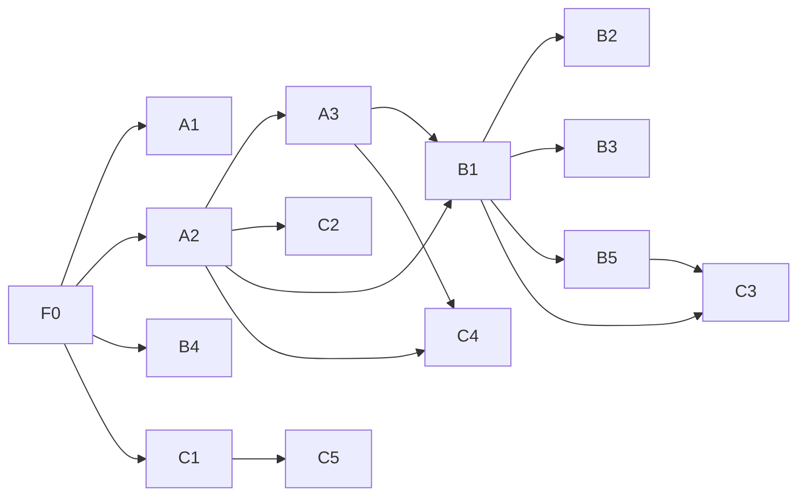

# Glide roadmap: real elements, interactions and the agent bridge

The plan for turning Glide's drawing tools into real, working page elements, adding Figma-style
interactions as plain code, and letting coding agents work through Glide. Work through it one item
at a time. Each item has its own spec file in this folder.

## How to resume

**With Claude Code**, paste this into a new session:

> Continue the Glide roadmap. Read `docs/roadmap/README.md`, take the next item, read its spec, and
> implement it step by step. When it's done, update the status board and the progress log.

**The routine, for Claude or by hand:**
1. Read this file. Take the row marked `in progress`. Otherwise, if a row is `needs commit`,
   `needs push` or `in review`, do the next step its note names. Committing, pushing and opening a
   PR still need the user's go-ahead. Otherwise take the first `todo` row whose dependencies are
   `done` or `in review`. When a dependency is only `in review`, branch from that dependency's
   branch (stacked PRs).
2. Read only that item's spec. Each spec is self-contained.
3. Run `git status`. Create or check out the branch named in the spec.
4. Follow the spec's steps in order. Write the failing test first where the spec says so.
5. Verify (see below).
6. Tick the spec's checklist, update its row below, and add one line to the progress log.
7. Commit and open a PR only when the user asks.

## Status board

| # | ID | Feature | Size | Depends on | Status |
|---|---|---|---|---|---|
| 1 | [F0](F0-layout-first-insert.md) | Land layout-first inserts | S | — | **in review**: PR #24 from `feat/f0-layout-first-insert`; `done` when merged |
| 2 | [A1](A1-layout-frames.md) | Frames lay out their children; `display` and radius class rules | S–M | F0 | **in review**: PR from `feat/a1-layout-frames` (stacked on F0) |
| 3 | [A2](A2-attribute-edit.md) | Attribute edit for HTML elements | M | F0 | todo |
| 4 | [A3](A3-tag-picker.md) | Tag picker (retag) | M | A2 | todo |
| 5 | [B1](B1-links.md) | Interactions panel: go to page, open URL, scroll to | M | A2, A3 | todo |
| 6 | [B2](B2-overlays.md) | Overlays with the Popover API | M | B1 | todo |
| 7 | [B3](B3-interaction-states.md) | Hover, press and focus states | S | B1 | todo |
| 8 | [B4](B4-animation.md) | Animation: transition duration and easing | S–M | F0 | todo |
| 9 | [B5](B5-routes.md) | Real route list (Pages panel and link targets) | M | B1 | todo |
| 10 | [C1](C1-mcp-bridge.md) | MCP bridge, step 1: read tools and safe edits | L | F0 | todo |
| 11 | [C2](C2-extract-component.md) | Extract component | L | A2 | todo |
| 12 | [C3](C3-page-transitions.md) | Page transitions (View Transitions) | M | B1, B5 | todo |
| 13 | [C4](C4-template-parity.md) | Vue, Svelte and Astro parity | L | A2, A3 | todo |
| 14 | [C5](C5-mcp-complete.md) | MCP bridge, steps 2–3: writes, presence, one-click setup | L | C1 | todo |

Status values: `todo`, `in progress`, `needs commit` (finished, not committed), `needs push`
(committed, not on GitHub), `in review` (PR open), `done` (merged).
Sizes: **S** is one focused change (a few files, roughly 100 lines with tests). **M** is several
files plus a piece of editor UI. **L** is a new subsystem; its spec splits it into steps.

## Why this order

- **A: make drawn elements real.** The layout, the tag and the attributes come first, because
  nothing interactive works on a box floating over the page.
- **B: interactions without JavaScript.** Links, anchors, popovers, state classes and transitions
  cover most of Figma's prototype features as plain HTML and CSS.
- **C: agents and scale.** The MCP bridge hands real logic to agents. C1 doesn't depend on A or B,
  so it can be pulled forward at any point.

## Ground rules (from Glide's code)

- **The source file is the only record.** Store no design or interaction data anywhere else. A
  feature reads itself back from the source, the way classes are read today.
- **One writer.** Every new element, attribute and class goes through ast-writer (`transformJSXBatch`
  calling `mutateClass`, `mutateStyle` or `mutateStructure`), so inserts and edits produce the same code.
- **Refuse what can't be done exactly.** Throw `CODE: message` errors (`UNSUPPORTED_OPERATION`,
  `INVALID_OPERATION`, `STALE_NODE` and so on) that tell the user what to do, and leave the file unchanged.
- **Static JSX only.** Dynamic expressions and spreads are refused.
- **A structural change runs in its own transaction** (the writer enforces this).
- **Follow the Style format.** Auto means Tailwind when the project has a Tailwind theme
  (`theme.version !== null`), and inline styles otherwise.
- **Validate at trust boundaries.** Allowlist attribute names, never write `javascript:` URLs, and never
  write event handlers from the editor. Handlers are the agent's job.
- **Every new rule, parser or branch gets a test** in `src/__tests__/`.
- **Keep agent docs current.** When behavior that agents rely on changes, update `skills/glide/SKILL.md`
  and the README's feature table.

## Verify

- Always: `npm test` and `npm run typecheck`.
- When `packages/overlay/src/editor-html.ts` or `packages/core/src/frame-queries.ts` changed:
  `npm run build && npm run test:artifact`.
- Before a release: `npm run verify:release`.
- By hand: the `test-site/` app. Rebuild Glide first; the `glide-test-apps` package is an older build.

## Known issues found while researching (verify before fixing)

1. **No `display` class rule.** Hiding or showing an element (`sendStyleChange(..., 'display', 'none')`
   in editor-html.ts) is probably refused in Tailwind projects. → A1
2. **Inserted ellipses get `rounded-[50%]`,** and a later radius edit matches only corner classes
   (`rounded-tl…`), so the classes conflict. → A1
3. **The flex direction, justify and gap controls exist, but nothing turns `display: flex` on.** → A1
4. **Pasteboard previews read inline styles only** (`safeStyles` in workspace-canvas.ts), so a
   Tailwind element shows without its look there. → later
5. **Attaching from the pasteboard writes `position: absolute`** with left/top (`attach` in
   structure.ts). → A1, optional step
6. **The Pages panel is a static placeholder** ("Page 1"). → B5
7. **The props inspector can't add attributes,** and `id` is blocked (`describe()` and `mutateProp()`
   in props.ts). → A2
8. **Template files (Vue, Svelte, Astro, HTML) only get class, style, layout and text edits.** → C4

## Gotchas

- **`editor-html.ts` builds the editor as one big template literal.** Its inline script can't contain
  raw backticks or `${`. Testable helpers are injected with `${fn.toString()}` (see
  `createMutationScope`), so put new logic in a small module and inject it the same way.
- **`frame-queries.ts` is injected as source text** into the editor and the Vite bridge. It must stay
  self-contained: no imports, no outside references.
- **Write files with LF line endings.** Python's text mode writes CRLF on Windows; fix with `sed -i 's/\r$//' <file>`.
- **`defaultTailwindTheme()` has `version: null` and empty color values.** Tests that expect
  Tailwind output must pass a versioned theme with colors (see the "project format" test in
  `src/__tests__/transaction-structures.test.ts`).
- **Recast wraps new style objects across lines.** Assert with a regex or by element order, not
  exact strings.

## Background (local notes, outside the repo)

`C:\Users\Srivarsan\Desktop\paper-re\`:
- `GLIDE-BLUEPRINT.md`: how Paper's agent integration works, mapped onto Glide (the basis for C1 and C5)
- `FIGMA-PROTOTYPE.md`: Figma's prototype data model mapped onto HTML and CSS (the basis for B1–B4 and C3)
- `REPORT.md`, `CONTEXT.md`

## Progress log

- 2026-11-21: Roadmap written. F0 implemented in the working tree on `main`, uncommitted: 6 files,
  `npm test` 444/444, typecheck, build and `test:artifact` all pass.
- 2026-11-21: F0 committed as `5504bb1` on `feat/f0-layout-first-insert`, and this roadmap committed
  on the same branch. Not pushed. Left for F0: the manual check in `test-site/`, then a PR. Its
  changelog entry goes in with the release.
- 2026-11-21: F0 manual check done in the real editor; placements correct. Fixed new elements sharing
  a line with their neighbour (`59e701d`, 448 tests pass). Not pushed yet: pushing needs the user's go-ahead.
- 2026-11-21: Pushed; PR #24 opened. Addressed CodeRabbit's review: reversed wrapping rows and stale
  sibling ids in code, plus the spec gaps it found. The user approved continuing with the rest of
  the roadmap after the review.
- 2026-11-21: A1 done on `feat/a1-layout-frames`: display and radius class rules, hide/show keeps the
  element's own display, frames start as auto layout, text hugs, an Auto layout button in the inspector,
  and children of an empty multi-line frame get their own lines. Confirmed hiding was refused in Tailwind
  projects before the fix. 455 tests pass; checked in the editor. The optional pasteboard attach step was
  not done.
