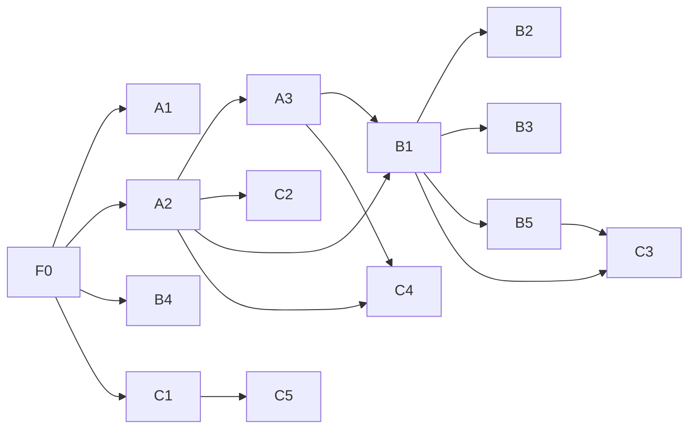

# Glide roadmap: real elements, interactions and the agent bridge

The plan for turning Glide's drawing tools into real, working page elements, adding Figma-style
interactions as plain code, and letting coding agents work through Glide. Work through it one item
at a time. Each item has its own spec file in this folder.

## How to resume

**With Claude Code**, paste this into a new session:

> Continue the Glide roadmap. Read `docs/roadmap/README.md`, take the next item, read its spec, and
> implement it step by step. When it's done, update the status board and the progress log.

**The routine, for Claude or by hand:**
1. Read this file. Take the row marked `in progress`. Otherwise, if a row is `needs commit`,
   `needs push` or `in review`, do the next step its note names. Committing, pushing and opening a
   PR still need the user's go-ahead. Otherwise take the first `todo` row whose dependencies are
   `done` or `in review`. When a dependency is only `in review`, branch from that dependency's
   branch (stacked PRs).
2. Read only that item's spec. Each spec is self-contained.
3. Run `git status`. Create or check out the branch named in the spec.
4. Follow the spec's steps in order. Write the failing test first where the spec says so.
5. Verify (see below).
6. Tick the spec's checklist, update its row below, and add one line to the progress log.
7. Commit and open a PR only when the user asks.

## Status board

| # | ID | Feature | Size | Depends on | Status |
|---|---|---|---|---|---|
| 1 | [F0](F0-layout-first-insert.md) | Land layout-first inserts | S | — | **in review**: PR #24 from `feat/f0-layout-first-insert`; `done` when merged |
| 2 | [A1](A1-layout-frames.md) | Frames lay out their children; `display` and radius class rules | S–M | F0 | **in review**: PR #25 (stacked on #24) |
| 3 | [A2](A2-attribute-edit.md) | Attribute edit for HTML elements | M | F0 | **in review**: PR #26 (stacked on #25) |
| 4 | [A3](A3-tag-picker.md) | Tag picker (retag) | M | A2 | **in review**: PR #27 (stacked on #26) |
| 5 | [B1](B1-links.md) | Interactions panel: go to page, open URL, scroll to | M | A2, A3 | **in review**: PR #28 (stacked on #27) |
| 6 | [B2](B2-overlays.md) | Overlays with the Popover API | M | B1 | **in review**: PR #29 (stacked on #28) |
| 7 | [B3](B3-interaction-states.md) | Hover, press and focus states | S | B1 | **in review**: PR #30 (stacked on #29) |
| 8 | [B4](B4-animation.md) | Animation: transition duration and easing | S–M | F0 | **in review**: PR #31 (stacked on #30) |
| 9 | [B5](B5-routes.md) | Real route list (Pages panel and link targets) | M | B1 | **in review**: PR #32 (stacked on #31) |
| 10 | [C1](C1-mcp-bridge.md) | MCP bridge, step 1: read tools and safe edits | L | F0 | **in review**: PR #33 (stacked on #32) |
| 11 | [C2](C2-extract-component.md) | Extract component | L | A2 | **in review** (same-file v1): PR #34 (stacked on #33) |
| 12 | [C3](C3-page-transitions.md) | Page transitions (View Transitions) | M | B1, B5 | **deferred**: see the spec for why |
| 13 | [C4](C4-template-parity.md) | Vue, Svelte and Astro parity | L | A2, A3 | **in review** (part 1: attributes, retag): PR #36 (stacked on #35) |
| 14 | [C5](C5-mcp-complete.md) | MCP bridge, steps 2–3: writes, presence, one-click setup | L | C1 | **in review** (part 1): PR #35 (stacked on #34) |

Status values: `todo`, `in progress`, `needs commit` (finished, not committed), `needs push`
(committed, not on GitHub), `in review` (PR open), `done` (merged), `deferred` (skipped for now; its spec says why).
Sizes: **S** is one focused change (a few files, roughly 100 lines with tests). **M** is several
files plus a piece of editor UI. **L** is a new subsystem; its spec splits it into steps.

## Why this order

- **A: make drawn elements real.** The layout, the tag and the attributes come first, because
  nothing interactive works on a box floating over the page.
- **B: interactions without JavaScript.** Links, anchors, popovers, state classes and transitions
  cover most of Figma's prototype features as plain HTML and CSS.
- **C: agents and scale.** The MCP bridge hands real logic to agents. C1 doesn't depend on A or B,
  so it can be pulled forward at any point.

## Ground rules (from Glide's code)

- **The source file is the only record.** Store no design or interaction data anywhere else. A
  feature reads itself back from the source, the way classes are read today.
- **One writer.** Every new element, attribute and class goes through ast-writer (`transformJSXBatch`
  calling `mutateClass`, `mutateStyle` or `mutateStructure`), so inserts and edits produce the same code.
- **Refuse what can't be done exactly.** Throw `CODE: message` errors (`UNSUPPORTED_OPERATION`,
  `INVALID_OPERATION`, `STALE_NODE` and so on) that tell the user what to do, and leave the file unchanged.
- **Static JSX only.** Dynamic expressions and spreads are refused.
- **A structural change runs in its own transaction** (the writer enforces this).
- **Follow the Style format.** Auto means Tailwind when the project has a Tailwind theme
  (`theme.version !== null`), and inline styles otherwise.
- **Validate at trust boundaries.** Allowlist attribute names, never write `javascript:` URLs, and never
  write event handlers from the editor. Handlers are the agent's job.
- **Every new rule, parser or branch gets a test** in `src/__tests__/`.
- **Keep agent docs current.** When behavior that agents rely on changes, update `skills/glide/SKILL.md`
  and the README's feature table.

## Verify

- Always: `npm test` and `npm run typecheck`.
- When `packages/overlay/src/editor-html.ts` or `packages/core/src/frame-queries.ts` changed:
  `npm run build && npm run test:artifact`.
- Before a release: `npm run verify:release`.
- By hand: the `test-site/` app. Rebuild Glide first; the `glide-test-apps` package is an older build.

## Known issues found while researching (verify before fixing)

1. **No `display` class rule.** Hiding or showing an element (`sendStyleChange(..., 'display', 'none')`
   in editor-html.ts) is probably refused in Tailwind projects. → A1
2. **Inserted ellipses get `rounded-[50%]`,** and a later radius edit matches only corner classes
   (`rounded-tl…`), so the classes conflict. → A1
3. **The flex direction, justify and gap controls exist, but nothing turns `display: flex` on.** → A1
4. **Pasteboard previews read inline styles only** (`safeStyles` in workspace-canvas.ts), so a
   Tailwind element shows without its look there. → later
5. **Attaching from the pasteboard writes `position: absolute`** with left/top (`attach` in
   structure.ts). → A1, optional step
6. **The Pages panel is a static placeholder** ("Page 1"). → B5
7. **The props inspector can't add attributes,** and `id` is blocked (`describe()` and `mutateProp()`
   in props.ts). → A2
8. **Template files (Vue, Svelte, Astro, HTML) only get class, style, layout and text edits.** → C4

## Gotchas

- **`editor-html.ts` builds the editor as one big template literal.** Its inline script can't contain
  raw backticks or `${`. Testable helpers are injected with `${fn.toString()}` (see
  `createMutationScope`), so put new logic in a small module and inject it the same way.
- **`frame-queries.ts` is injected as source text** into the editor and the Vite bridge. It must stay
  self-contained: no imports, no outside references.
- **Write files with LF line endings.** Python's text mode writes CRLF on Windows; fix with `sed -i 's/\r$//' <file>`.
- **`defaultTailwindTheme()` has `version: null` and empty color values.** Tests that expect
  Tailwind output must pass a versioned theme with colors (see the "project format" test in
  `src/__tests__/transaction-structures.test.ts`).
- **Recast wraps new style objects across lines.** Assert with a regex or by element order, not
  exact strings.

## Background (local notes, outside the repo)

`C:\Users\Srivarsan\Desktop\paper-re\`:
- `GLIDE-BLUEPRINT.md`: how Paper's agent integration works, mapped onto Glide (the basis for C1 and C5)
- `FIGMA-PROTOTYPE.md`: Figma's prototype data model mapped onto HTML and CSS (the basis for B1–B4 and C3)
- `REPORT.md`, `CONTEXT.md`

## Progress log

- 2026-11-21: Roadmap written. F0 implemented in the working tree on `main`, uncommitted: 6 files,
  `npm test` 444/444, typecheck, build and `test:artifact` all pass.
- 2026-11-21: F0 committed as `5504bb1` on `feat/f0-layout-first-insert`, and this roadmap committed
  on the same branch. Not pushed. Left for F0: the manual check in `test-site/`, then a PR. Its
  changelog entry goes in with the release.
- 2026-11-21: F0 manual check done in the real editor; placements correct. Fixed new elements sharing
  a line with their neighbour (`59e701d`, 448 tests pass). Not pushed yet: pushing needs the user's go-ahead.
- 2026-11-21: Pushed; PR #24 opened. Addressed CodeRabbit's review: reversed wrapping rows and stale
  sibling ids in code, plus the spec gaps it found. The user approved continuing with the rest of
  the roadmap after the review.
- 2026-11-21: A1 done on `feat/a1-layout-frames`: display and radius class rules, hide/show keeps the
  element's own display, frames start as auto layout, text hugs, an Auto layout button in the inspector,
  and children of an empty multi-line frame get their own lines. Confirmed hiding was refused in Tailwind
  projects before the fix. 455 tests pass; checked in the editor. The optional pasteboard attach step was
  not done.
- 2026-11-21: A1 follow-up: Tailwind v4 sorts `inline-block` after `hidden`, so hide writes `hidden!` there
  (checked against Tailwind 4.0.0; v3 defines `hidden` last). A2 done on `feat/a2-attribute-edit`: an
  `attribute` change with an allowlist, script-link and duplicate-id refusals, automatic `rel` for new tabs,
  and Add/remove controls in the props inspector. 460 tests pass. The UI was not clicked through live.
- 2026-11-21: A3 done on `feat/a3-retag`: a `retag` structural change with HTML validity checks and a tag
  dropdown in the Properties header. Checked both A2 and A3 in the editor: the tag dropdown rewrote `div` to
  `section`; Add attribute wrote `title`; a `javascript:` href was refused with a visible message. Prop
  edits queue in Staged mode like every other prop edit. 464 tests pass.
- 2026-11-21: B1 done on `feat/b1-links`: an Interactions panel (Nothing, Go to page, Open URL, Scroll to)
  backed by `packages/overlay/src/interactions.ts`. Each interaction is one `retag` that also carries the link
  attributes, so it is a single exact edit. Scroll-to offers the page's unique ids; picking a target on the
  canvas is deferred (give the target an id with A2 first). Checked in the editor: a div became
  `<a href="#features">` and the panel read it back. 470 tests pass.
- 2026-11-21: B2 done on `feat/b2-overlays`: Open overlay and Close overlay in the Interactions panel, each one
  `retag` to `<button type="button">` with `popoverTarget` (and `popoverTargetAction="hide"` to close), plus a
  Show button that opens an overlay on the canvas so it can be edited. Overlays are elements with a unique id and
  the `popover` attribute (A2 can add both). Checked in the editor with React 19: the written button renders
  `popovertarget`, and in Preview the trigger opened the overlay and Close hid it. 472 tests pass. Not done:
  placement and backdrop options; React 18 rendering of `popoverTarget` not checked.
- 2026-11-21: CodeRabbit's free plan rate-limited the stacked PR reviews; they are requested one at a time.
  B3 done on `feat/b3-states`: Hover, Pressed and Focus buttons in the Interactions panel switch the header's
  state picker, and a line lists the state classes the element has; inline-format projects get an explanation
  instead. Checked in the editor (inline and Tailwind format). 473 tests pass. The transition offer moves to B4.
- 2026-11-21: B4 done on `feat/b4-animation`: class rules for transition property, duration (v3 scale, any whole
  number in v4, else arbitrary) and easing; an empty value now removes a property's classes everywhere, including
  inside `cn()`/`cva` (also fixes A1's show in class expressions); an Animate row in the Interactions panel
  writes the transition on the normal look. Checked in the editor (inline): 200 ms written, read back, and removed.
  477 tests pass. Not done: delay, springs, `@starting-style` enter animations.
- 2026-11-21: Addressed CodeRabbit's review of A1 (#25: visibility toggle sends an empty display, text by click
  has no width, important display classes, conditional `hidden`, display edits keep hidden elements hidden) and
  merged it up the stack. B5 done on `feat/b5-routes`: `listRoutes()` in core for Next.js (App and Pages Router),
  SvelteKit and Astro; a `list-routes` server message; the Pages panel lists routes and navigates the preview;
  Go to page suggests them. Checked in the editor with a temporary Next.js layout. 484 tests pass. Not done:
  refreshing the list when route files are added, and a visited-URL list for apps without file routes.
- 2026-11-21: Addressed CodeRabbit's review of A2 (#26: character references in links, duplicate rel, typed prop
  values, fuller attribute controls) and merged it up the stack. C1 done on `feat/c1-mcp` without the MCP SDK:
  a JSON-RPC endpoint at `/__glide/mcp` (bearer token from a 0600 run file, browsers refused), seven tools
  (project info, selection, tree, source, update_styles, set_text, delete_element), `glide mcp` stdio bridge
  (lists tools while Glide is stopped) and `glide mcp install` for Claude Code. Checked end to end: the CLI read
  the editor's selection and changed the heading's color through Glide. 492 tests pass.
- 2026-11-21: C2 v1 done on `feat/c2-extract`: an `extract` structural change moves static markup into
  `function Name()` above the component, in the same file, and uses `<Name />` in its place (one transaction, normal
  undo). Refuses markup that uses the surrounding component's variables, list items with a key, and taken or
  badly formed names. A Component section in the inspector runs it. Checked in the editor. 495 tests pass.
  Not done: a file of its own (needs multi-file undo that can delete a created file) and props (v2).
- 2026-11-21: C3 deferred (multi-page sites only, needs injected JavaScript for "none" and a CSS writer undo can't
  track; agents can add the rule). C5 part 1 on `feat/c5-mcp-tools`: set_attribute, retag, duplicate_element,
  move_element, extract_component and get_guide, plus `glide mcp install --agent cursor|vscode|all`. 496 tests pass.
- 2026-11-22: C4 part 1 on `feat/c4-attributes`: attribute edits and retag in Vue, Svelte, Astro and HTML through
  shared rules (`checkAttributeValue`, `checkRetag`), so the Interactions panel and the MCP tools work there. Checked
  in the Vue test app, including undo. 518 tests pass. Insert, delete and move in templates are deferred.
- 2026-11-22: Addressed CodeRabbit's reviews of #27–#32 on their own branches and merged them up the stack: stricter
  retag checks, interaction form state, safe toast text, Close overlay checks, case-insensitive JSX attributes,
  animation reading order, and route rules per router. Summaries are on each PR. 521 tests pass.
